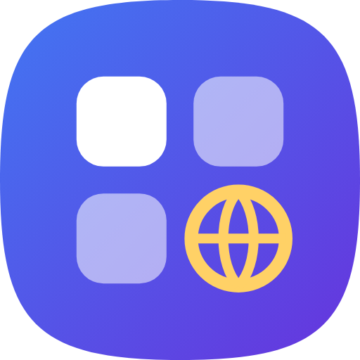

# Web Launcher (Android nativo)

Launcher di web app in **Kotlin / Android nativo**.

## Funzioni
- Griglia app con categorie e preferiti
- Ricerca testo + **Cerca sul web**
- **Voce nativa** (`RecognizerIntent` di Android, non WebView)
- Tieni premuto su un\u2019app \u2192 Preferiti / Modifica / Elimina
- Aggiungi app, backup JSON, reset
- Apertura link in Chrome Custom Tabs

## Voce
Usa il riconoscimento vocale di sistema (Google).
Richiede permesso **Microfono** e Google app / speech services.

## Build
Push su qualsiasi branch o pull request → GitHub Actions genera l’APK di anteprima (`web-launcher-native-apk`).

```bash
./gradlew assembleDebug
```

## Mia AI integrata
L'app [mia-ai-app](https://github.com/micmax1000-afk/mia-ai-app) è inclusa in `app/src/main/assets/mia-ai`
e si apre dentro il browser (Impostazioni → App integrate → Mia AI).
Microfono e lettura vocale usano la voce nativa di Android.
Per aggiornarla: `./scripts/update-mia-ai.sh`.

## AI nel launcher
Usa provider, chiave e modello configurati in Mia AI (pagina ponte `assets/wl-ai/bridge.html`
sulla stessa origine, con il codice dei provider di Mia AI):
riassumi pagina, chiedi alla pagina, risposta rapida dalla ricerca, spiegazione del testo selezionato,
comandi vocali interpretati dall'AI.

## Notizie
Aggregatore RSS: 64 fonti in `app/src/main/assets/news/sources.json` (nazionali, economia, sport, tecnologia,
scienza, esteri, cultura, motori, viaggi, Piemonte, Lombardia, Umbria, internazionali) più fonti aggiunte
dall'utente. Il workflow **Check news feeds** controlla i feed a ogni modifica (`scripts/check_feeds.py`).
